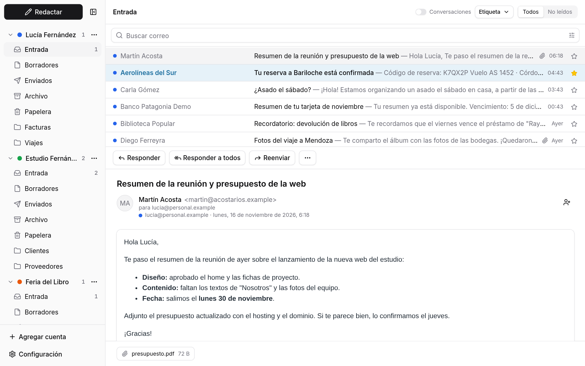
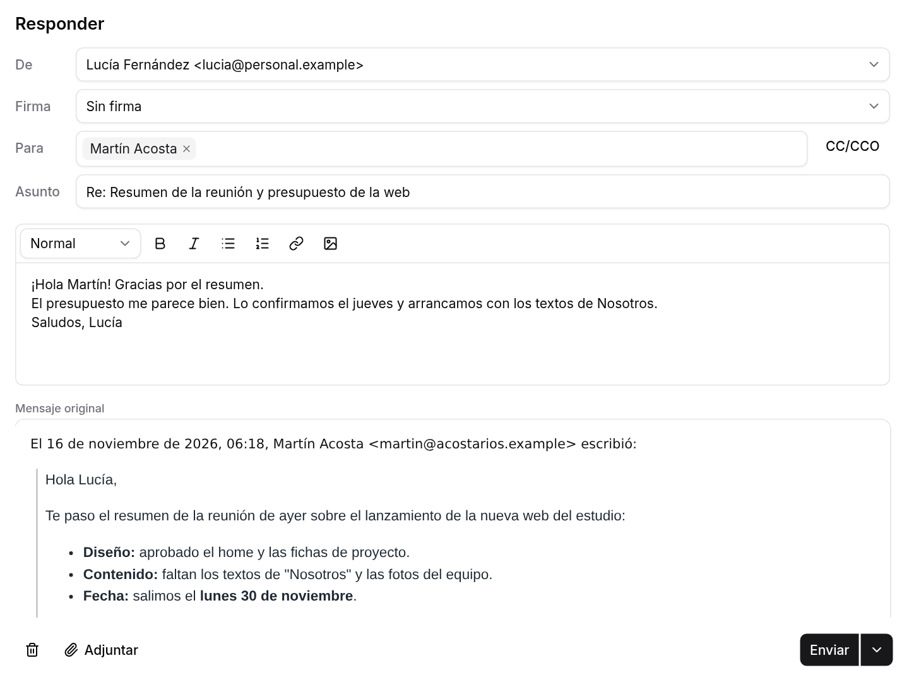
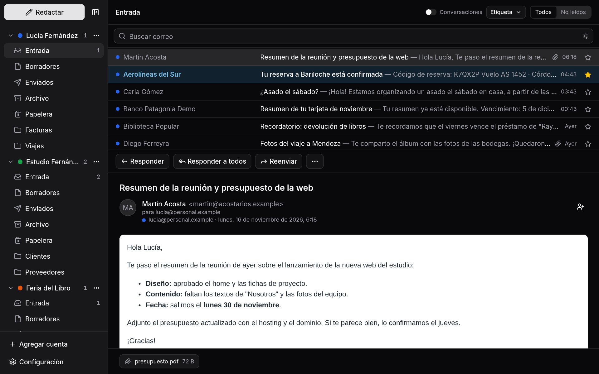

<p align="center">
  
</p>

<h1 align="center">PostaControl</h1>

<p align="center">
  Cliente de correo de escritorio para Linux, moderno y liviano.<br>
  Todas tus cuentas IMAP en una sola ventana.
</p>

<p align="center">
  <a href="https://github.com/fspiritosi/postacontrol/releases/latest"></a>
  <a href="https://github.com/fspiritosi/postacontrol/actions/workflows/check.yml"></a>
  
</p>

---

## ¿Qué es?

PostaControl es un cliente de correo para el escritorio, pensado como reemplazo
de Thunderbird para quien en el día a día **recibe, lee y manda correo** y
quiere una interfaz actual. Se conecta a cualquier servidor **IMAP/SMTP**
(Hostinger, Gmail con contraseña de aplicación, servidores propios, etc.) y
maneja varias cuentas a la vez.

El servidor sigue siendo la fuente de verdad: la app guarda una copia local
para leer y buscar rápido, incluso sin conexión, y nunca mueve ni borra correo
en el servidor si no se lo pedís.

## Capturas

<p align="center">
  
</p>

| Redactor | Tema oscuro |
|---|---|
|  |  |

<sub>Las capturas usan cuentas y correos de demostración.</sub>

## Para qué sirve

- **Juntar varias cuentas** en una sola app, cada una con su color y su
  contador de no leídos, o en una bandeja unificada.
- **Leer y ordenar** el correo con etiquetas, colores de carpeta, reglas
  automáticas y vista por conversaciones.
- **Escribir rápido** con un redactor de texto enriquecido, firmas, plantillas
  y autocompletado de contactos.
- **No perderse nada:** el correo nuevo llega al instante (IMAP IDLE) con
  notificación del escritorio, y la app sigue en la bandeja del sistema al
  cerrar la ventana.

## Funciones

**Bandeja y lectura**

- Varias cuentas IMAP/SMTP con autoconfiguración de servidores.
- Bandeja unificada opcional o un árbol de carpetas por cuenta.
- Conversaciones, etiquetas, destacados y colores por carpeta.
- Sidebar plegable a una columna de íconos para pantallas chicas.
- Imágenes remotas bloqueadas por defecto, con permiso por remitente.
- HTML aislado y sin scripts: un correo malicioso no puede ejecutar código.
- Invitaciones de calendario (`.ics`) legibles dentro del correo.
- Desuscribirse de un newsletter con un clic.
- Imprimir o guardar como PDF, ver el código fuente y guardar como `.eml`.

**Organización**

- Reglas por cuenta: mover, marcar como leído, destacar, etiquetar o mandar a
  la Papelera según remitente, destinatario o asunto.
- Archivar, posponer un correo hasta la hora que elijas y vaciar la Papelera
  de una vez.
- Deshacer la última acción (`z`).

**Redacción**

- Redactor de texto enriquecido con menú `/` y corrector ortográfico.
- Firmas por cuenta, plantillas y respuestas rápidas.
- Programar el envío y deshacer un envío durante 10 segundos.
- Arrastrar destinatarios entre Para, CC y CCO.
- Atiende los enlaces `mailto:` del sistema.

**Búsqueda**

- Búsqueda local, rápida y sin conexión, con filtros: `de:`, `para:`,
  `asunto:`, `tiene:adjunto`, `es:no-leído`, `es:destacado`, `desde:` y
  `hasta:`.
- Si el índice local no cubre todo, busca también en el servidor.

**Tareas**

- Tareas locales con aviso de escritorio y anticipación configurable.
- Crear una tarea o un ticket de Taskapp desde un correo, con el original
  adjunto y el proyecto sugerido según el remitente.
- Sumar las respuestas posteriores del hilo a la tarea.
- Ver tus tareas pendientes de Taskapp.
- Conectar con Taskapp desde Configuración → Taskapp.

**Calendario**

- Vista Calendario: semana laboral por defecto, y día, semana, mes o agenda.
- Eventos con repetición y aviso de escritorio antes de que empiecen.
- Invitaciones por correo: mandalas, recibilas y respondé desde el correo
  (Aceptar, Tal vez, Rechazar). Compatibles con Google Calendar y Outlook.
- Las tareas con fecha aparecen en el calendario.
- Reuniones de Taskapp: verlas y crearlas, con invitados externos y aviso
  cuando alguien cambia la hora en Taskapp.
- Importar desde Google Calendar (el `.zip` o los `.ics` que exporta), en
  Configuración → Calendario.
- Limitación: no hay sincronización con Google ni CalDAV, y no hay app móvil.
  Los eventos viven en esta PC (van en el respaldo).

**Tus datos**

- Contraseñas en el llavero del sistema (KWallet o GNOME Keyring), nunca en
  texto plano.
- Respaldo de contactos, firmas, etiquetas, reglas, plantillas, tareas locales y eventos,
  manual o automático cada semana.
- Tema Sistema, Claro u Oscuro.

### Atajos de teclado

| Tecla | Acción |
|---|---|
| `j` / `k` | Correo siguiente / anterior |
| `r` / `a` / `f` | Responder / Responder a todos / Reenviar |
| `e` | Archivar |
| `Supr` | Mandar a la Papelera |
| `s` / `u` | Destacar / Marcar como no leído |
| `n` | Redactar |
| `t` | Crear tarea desde el correo |
| `/` | Buscar |
| `z` | Deshacer |
| `?` | Ver todos los atajos |

## Instalación

PostaControl se distribuye para **Linux (x86_64)**. Los paquetes de cada
versión están en [Releases](https://github.com/fspiritosi/postacontrol/releases/latest).

| Sistema | Paquete | Estado |
|---|---|---|
| Ubuntu 24.04 o posterior | `.deb` | ✅ Disponible |
| Debian 13 o posterior | `.deb` | ✅ Disponible |
| Fedora 42 o posterior | `.rpm` | ✅ Disponible |
| Otras distribuciones | Compilar desde el código | ⚙️ Ver más abajo |
| Windows / macOS | — | ❌ No disponible por ahora |

El gestor de paquetes instala solo lo que la app necesita: GTK4, WebKitGTK 6,
los diccionarios del corrector (español e inglés) y `xdg-utils`.

### Ubuntu y Debian

1. Bajá el archivo `postacontrol_X.Y.Z_amd64.deb` de la
   [última versión](https://github.com/fspiritosi/postacontrol/releases/latest).
2. Instalalo desde la carpeta donde lo bajaste:

   ```sh
   sudo apt install ./postacontrol_X.Y.Z_amd64.deb
   ```

### Fedora

1. Bajá el archivo `postacontrol-X.Y.Z-1.x86_64.rpm` de la
   [última versión](https://github.com/fspiritosi/postacontrol/releases/latest).
2. Instalalo:

   ```sh
   sudo dnf install ./postacontrol-X.Y.Z-1.x86_64.rpm
   ```

### Desde la terminal, con `gh`

Si tenés la [CLI de GitHub](https://cli.github.com/), esto baja la última
versión sin pasar por el navegador:

```sh
# Ubuntu / Debian
gh release download -R fspiritosi/postacontrol -p '*.deb' -D /tmp/postacontrol
sudo apt install /tmp/postacontrol/postacontrol_*_amd64.deb

# Fedora
gh release download -R fspiritosi/postacontrol -p '*.rpm' -D /tmp/postacontrol
sudo dnf install /tmp/postacontrol/postacontrol-*.x86_64.rpm
```

### Verificar la descarga

Cada versión trae un archivo `SHA256SUMS`. Con el paquete y ese archivo en la
misma carpeta:

```sh
sha256sum -c SHA256SUMS --ignore-missing
```

### Actualizar

El mismo comando de instalación, con el paquete nuevo, actualiza la versión
anterior. Tus cuentas y tu correo se conservan. Después de actualizar, salí de
la app desde el ícono de la bandeja (**Salir**) y volvé a abrirla.

> [!NOTE]
> Algunas versiones actualizan la base de datos local. Cuando eso pasa, las
> notas de la versión lo avisan, y una versión anterior ya no puede abrirla.

### Desinstalar

```sh
sudo apt remove postacontrol   # Ubuntu / Debian
sudo dnf remove postacontrol   # Fedora
```

Tus datos locales (caché del correo, contactos, firmas y configuración) quedan
en `~/.local/share/postacontrol` por si volvés a instalarla. Para borrarlos
también, eliminá esa carpeta. Las contraseñas están en el llavero del sistema.

## Primeros pasos

1. Abrí **PostaControl** desde el menú de aplicaciones.
2. Agregá una cuenta con tu correo y tu contraseña. La app intenta detectar
   los servidores IMAP y SMTP; si no puede, los cargás a mano. Antes de
   guardar, prueba la conexión.
3. Opcional: elegila como **cliente de correo predeterminado** para que los
   enlaces `mailto:` la abran.
   - **KDE:** *Preferencias del sistema → Aplicaciones predeterminadas →
     Cliente de correo*.
   - **GNOME:** *Configuración → Aplicaciones predeterminadas → Correo*.
   - **Terminal:**

     ```sh
     xdg-mime default ar.com.codecontrol.postacontrol.desktop x-scheme-handler/mailto
     ```

4. Opcional: en *Configuración → General*, activá **Iniciar al abrir sesión**.

Al cerrar la ventana, la app queda en la bandeja del sistema y sigue
recibiendo correo. Para cerrarla del todo, usá **Salir** desde el ícono de la
bandeja.

## Compilar desde el código

Para otras distribuciones o para desarrollar. Hace falta:

- [Go](https://go.dev/dl/) 1.27 o posterior
- [Node.js](https://nodejs.org/) 22
- [Task](https://taskfile.dev/)
- La CLI de [Wails 3](https://v3.wails.io/), en la misma versión que figura
  en `go.mod`
- Las librerías de desarrollo de GTK4 y WebKitGTK 6:

  ```sh
  sudo apt install libgtk-4-dev libwebkitgtk-6.0-dev        # Ubuntu / Debian
  sudo dnf install gtk4-devel webkitgtk6.0-devel            # Fedora
  ```

Instalar Task y Wails:

```sh
go install github.com/go-task/task/v3/cmd/task@latest
go install "github.com/wailsapp/wails/v3/cmd/wails3@$(go list -m -f '{{.Version}}' github.com/wailsapp/wails/v3)"
```

Comandos principales:

| Comando | Qué hace |
|---|---|
| `wails3 dev` | Abre la app en modo desarrollo, con recarga en caliente |
| `task build` | Compila el binario en `bin/postacontrol` |
| `task check` | Verificación completa: `go vet`, tests de Go, tipos, tests y lint del frontend |
| `task package` | Arma el `.deb` y el `.rpm` en `bin/` |
| `task install:desktop` | Instala la app en `~/.local` (binario, íconos y lanzador), sin paquete |

## Tecnología

| Parte | Herramientas |
|---|---|
| Escritorio | [Wails 3](https://v3.wails.io/) sobre GTK4 y WebKitGTK 6 |
| Núcleo de correo | Go: IMAP, SMTP, MIME y SQLite con búsqueda FTS5 |
| Interfaz | React, TypeScript, Vite, Tailwind y shadcn/ui |
| Redactor | TipTap |

El núcleo de correo (`core/`) no depende de Wails: la cáscara de escritorio
(`app/`) solo lo conecta con la interfaz (`frontend/`). Así el mismo núcleo se
podría exponer como API para otra interfaz.

```
core/       núcleo de correo: IMAP, SMTP, MIME, almacenamiento, llavero
app/        servicios de Wails, bandeja del sistema, notificaciones, mailto:
frontend/   interfaz en React
build/      íconos, lanzador y configuración de paquetes por plataforma
docs/       diseños, planes y notas de cada versión
```

## Versiones

Las novedades de cada versión están en
[Releases](https://github.com/fspiritosi/postacontrol/releases) y en
[`docs/releases/`](docs/releases/). Cómo publicar una versión nueva está en
[`docs/releases/README.md`](docs/releases/README.md).
